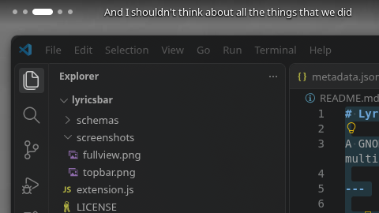
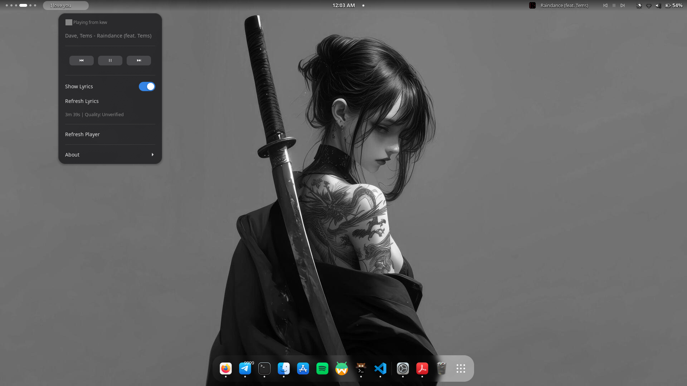

# LyricsBar

A GNOME Shell extension that puts synchronized lyrics, playback controls and real-time audio-quality metrics straight into your top bar. LyricsBar attaches to any active MPRIS media player (preferring Spotify) and shows what's playing — and what's being sung — without ever leaving the panel.

---

## 📸 Screenshots

### Top Bar Display


### Dropdown Menu & Quality Metrics


---

## ✨ Features

### Multi-source Lyrics Finder & Resilient Polling

- Queries LRCLIB's exact-track endpoint as well as its title/artist search, matching the current album and duration where available.
- Picks the closest synced result within 5 seconds of the playing track's duration.
- Falls back to lyrics.ovh plain-text lyrics when LRCLIB has no synced match; since those lyrics carry no timestamps, lines are spaced evenly across the track duration.
- **Resilient Retry Polling**: if the lyrics API returns an error (e.g. HTTP 503 Service Unavailable) or another transient failure, LyricsBar runs backup retries at staggered intervals (1s, 3s, 6s, 12s) for up to 30 seconds per song before cleanly stopping.
- Seamlessly falls back to the track title if no synced lyrics match, preventing stuck first lines or unsynced plain text.

### Audio Quality Inspector (zero-debug, fully native)

- Measures real download payload sizes and content bitrates **directly inside GNOME Shell** — no Spotify debug flags, wrapper scripts, or external Python daemons required.
- Inspects the active player's file descriptors in Linux `/proc/<pid>/fd/` and cursor positions (`pos:`) to identify the exact audio file in real time.
- **1-Second Stability Sampling**: flags tracks as `Buffering (<size>MB)` while a download is in progress, so premature bitrates are never shown — the accurate bitrate is calculated once the byte count stabilizes.
- **10-Second Stream Polling**: non-blocking periodic checks detect chunk growth on long tracks and podcasts and refresh the metrics dynamically.

### Scrolling Animations

- **Horizontal Slide (Title → Lyrics)**: when a song starts, the title appears immediately. As soon as synced lyrics are loaded, the title slides out to the left and the first lyric slides smoothly in from the right.
- **Vertical Roll (Line → Line)**: subtle vertical roll transitions animate subsequent lyric lines as playback advances.

### Duration & Live Stream Metrics

- Displays the formatted song duration alongside the real measured bitrate and stream cache size directly in the dropdown menu:
  ```text
  {duration} | ~{bitrate}kbps ({size}MB)
  ```
  *(e.g. `4m 55s | ~316kbps (11.1MB)`)*

### MPRIS Tracking & Clean Panel Presence

- Monitors active MPRIS players, preferring Spotify when it is available.
- Keeps the track title in the panel when lyrics are unavailable, and provides a **Refresh Lyrics** menu action to retry.
- Automatically hides from the top bar when no MPRIS player is running — no clutter, no empty placeholder text.

### Interactive Playback Controls

- Control the connected player directly from the panel menu with Prev, Play/Pause, and Next buttons.

---

## 🚀 Installation

### User Installation (Recommended):

```bash
git clone https://github.com/babywhocodes/lyricsbar
cd lyricsbar
mkdir -p ~/.local/share/gnome-shell/extensions/lyricsbar@devic1
cp -r . ~/.local/share/gnome-shell/extensions/lyricsbar@devic1/
```

### Reloading the Extension:

- **On GNOME on Xorg (X11)**:
  Press `Alt + F2`, type `r`, and press `Enter`.
- **On Wayland**:
  Log out and log back in.

### Enable the Extension:

```bash
gnome-extensions enable lyricsbar@devic1
```

Or enable it via the **GNOME Extensions** application.

---

## 🛠️ Development & Debugging

### View Extension Logs:
```bash
journalctl -f -o cat /usr/bin/gnome-shell | grep -i spotify
```

### Verify MPRIS Connection:
```bash
dbus-send --print-reply --dest=org.mpris.MediaPlayer2.spotify /org/mpris/MediaPlayer2 org.freedesktop.DBus.Properties.Get string:org.mpris.MediaPlayer2.Player string:Metadata
```
# lyricsbar
